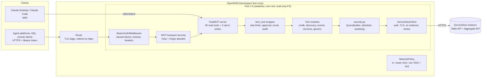

# Architecture

## The big picture

There is one code path for both transports. With **stdio**, the MCP client starts the server as a local process and talks over stdin/stdout. With **HTTP**, requests arrive at `/mcp` (streamable HTTP, stateless, JSON responses) through the OpenShift Route, and must pass the bearer-token middleware and the Host/Origin checks first.

## A request, step by step

Example: the model calls `alerts_list(severity="Critical", node="web")`.

1. **Transport / authentication (HTTP only).** `BearerAuthMiddleware` checks the client address against the lockout, then compares the token in constant time with every configured client token. On success it writes the client name (for example `dify`) into the request scope. The MCP transport then checks `Host` and `Origin`.
2. **FastMCP** validates the arguments against the tool's JSON schema (types, enums, ranges) and calls the tool. Our wrapper also receives the MCP `Context`; it is hidden from the schema.
3. **`itom_tool` wrapper** (`tools/common.py`), the single choke point for every tool:
   - identifies the client (`dify`, or `local` for stdio) and applies that client's **rate limit**;
   - for write tools: applies the **write rate limit**, then asks the **human** to approve through MCP elicitation (or, if configured, checks `confirm=true`);
   - runs the tool;
   - **scrubs** the result: drops secret and PII fields, strips hidden Unicode and ANSI, neutralises markdown images and HTML, flags prompt-injection phrasing, truncates long strings;
   - prepends `_notice` (the data is untrusted), adds `_security_warnings` if anything was neutralised, and **caps** the total size;
   - turns every exception into a safe error (`invalid_input`, `sn_forbidden`, …, or `internal` with a reference id);
   - writes one **audit** line: client, tool, outcome, duration and a truncated argument summary.
4. **Tool function** (`tools/events.py` here) turns friendly inputs into a query. `"Critical"` is mapped to the stored value `1`, and `node` becomes a `LIKE` filter. It builds the query **only** through `QueryBuilder`.
5. **`QueryBuilder` / `security.py`** validates every piece:
   - field names: identifier regex, not secret, not PII, not denied for this table;
   - operators: from a fixed list;
   - values: no `^`, no `javascript:`, no control or invisible characters, checked raw and NFKC-normalised.

   The result is `stateINOpen,Reopen,Flapping^severityIN1,2^nodeLIKEweb^ORDERBYDESCsys_updated_on`.
6. **`ServiceNowClient`** checks the table against the allowlist, builds the URL from the validated instance URL plus the table name, adds the auth header (`AuthManager`), and sends the request. TLS is verified, redirects are refused, the timeout is enforced, and concurrency is limited by a semaphore. It retries 429/5xx up to twice, refreshes the OAuth token once on a 401, and refuses non-JSON or oversized responses.
7. The response travels back up through the wrapper (step 3) to the model. It includes `query_used`, `total_count` and `next_offset`, so the model can explain and page its answer.

## Modules

| File | Responsibility |
|---|---|
| `cli.py` | Entry point: `itom-mcp` (stdio) or `itom-mcp --transport http`. Loads `.env`, validates config (exit code 2 on errors), configures logging, starts uvicorn for HTTP. |
| `config.py` | Reads every setting from env or `*_FILE` and validates it fail-fast. The ServiceNow auth variables are identical to `oricohen392/mcp-snow`. Holds secrets as `SecretStr`. Enforces https, the host allowlist and a same-host OAuth token URL. Parses named client tokens. |
| `auth.py` | `AuthManager`: Basic header / OAuth (`client_credentials`, then the `password` grant, with Basic `client_id:secret` at the token endpoint, the same flow as mcp-snow) / API-key header. Caches the token with expiry; refreshes are serialised by a lock. |
| `client.py` | `ServiceNowClient`: Table API (`query`, `get`, `patch`) and Aggregate API (`aggregate`, `count`). All URL construction, TLS, redirects, retries, error classification and size limits live here. |
| `security.py` | Input sanitising, the `QueryBuilder`, table and field allowlists and denylists (secrets, PII, per-table), date parsing, output scrubbing (injection flags, hidden Unicode, exfiltration links), response capping, log redaction, rate limiters, auth-failure lockout. No network code. |
| `server.py` | Builds the FastMCP server (instructions, stateless HTTP, 1 MB body limit, transport security) and registers all tool modules. Contains the HTTP app (`/healthz`, `/mcp`) and `BearerAuthMiddleware`. |
| `tools/common.py` | The `itom_tool` decorator described above, `Ctx` (shared state), choice maps (status, severity labels ↔ values), CI resolution (sys_id / name / IP / FQDN, with ambiguity errors), and the list-response format. |
| `tools/cmdb.py` | Classes, CI search, CI details, relationships, BFS impact analysis (bounded depth and nodes), counts, health report, duplicates, recent changes, overview. |
| `tools/discovery.py` | Discovery schedules, runs, run summary, logs, device history, failure summary, IP ranges; MID Servers, MID health, ECC queue. |
| `tools/events.py` | Alerts (list, details, summary), events (list, volume), event/alert rules, connectors; the three opt-in alert writes. |
| `tools/services.py` | Application/business services, service map (Service Mapping `svc_ci_assoc`), service health, CI operational summary, outages. |
| `tools/generic.py` | `list_itom_tables`, `itom_query` / `itom_count` (structured filters on allowlisted tables only), `check_access`. |

## Key design decisions

- **Structured filters, never raw queries.** The model can't send an encoded query, so it can't inject one. The generic tools take `[{field, op, value}]`, and everything is validated.
- **Allowlist, not denylist, for tables.** New or unknown tables are unreachable by default; CI classes are allowed by the `cmdb_ci_*` pattern.
- **One decorator for all cross-cutting security.** No tool can forget rate limiting, scrubbing, auditing or error handling, because a tool can only be registered through `itom_tool`.
- **Read-only by default; the human approves writes.** Write tools aren't even registered unless `READ_ONLY=false`, and the model can never approve its own write in the default mode.
- **Stateless HTTP.** No sessions in memory, so OpenShift can scale replicas behind the Route without sticky sessions. The trade-off is no server-to-client requests, so no elicitation over HTTP.
- **Aggregate API for "how many" questions.** Counts and group-bys run server-side in ServiceNow instead of downloading records.
- **Errors are data.** ServiceNow failures come back as `success:false` with a typed `error_type` and a hint, never as an empty "0 results" that the model would misreport.

## Deployment topology

- `BuildConfig` + `ImageStream`: build in-cluster from the repo (binary build or Git).
- `Deployment` (2+ replicas): non-root, read-only root filesystem, capabilities dropped, seccomp, no service-account token. Secrets are mounted as files (`*_FILE`). Probes hit `/healthz`.
- `ConfigMap`: all non-secret settings. `Secret`: ServiceNow credentials and the client tokens file.
- `Service` + `Route`: TLS edge, HTTP redirected to HTTPS, 120 s timeout.
- `NetworkPolicy`: ingress only from the router (and the namespace); egress only DNS and 443. `PodDisruptionBudget`: at least 1 pod stays up.

## Testing

`tests/` has 136 tests using mocked ServiceNow HTTP (`respx`) and real MCP clients (in-memory for elicitation, Starlette TestClient for HTTP). They cover config validation, all three auth modes, the OAuth fallback and refresh, redirect refusal, retries, error classification, query building and injection rejection (including Unicode), PII and secret blocking, output scrubbing, response capping, human approval (approve, deny, decline), rate limits, named tokens, lockout, Host/Origin checks and security headers. CI also runs bandit, pip-audit, gitleaks and a hidden-Unicode check.
